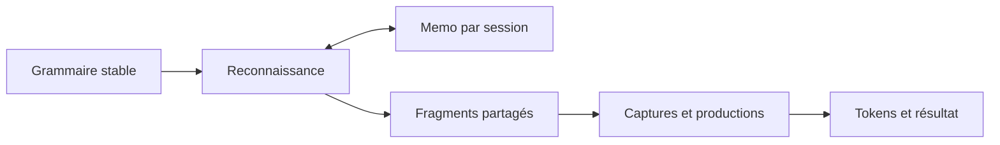

# Diagnostic du Packrat de js-parsec

Diagnostic du **14 octobre 2026**, sur `@cyann/js-parsec` **1.0.0**,
HEAD **`100107a`**, avec les modifications locales présentes dans le workspace.
Les numéros de ligne correspondent aux fichiers examinés à cette date.
Ce document complète [peg-to-packrat.md](peg-to-packrat.md) avec les défauts
reproduits sur l'implémentation actuelle et les corrections proposées.

## 1. Conclusion et état vérifié

**Le cache fonctionne, mais son résultat mémorisé ne suffit pas à reproduire
les effets du parsing.** Une seconde erreur mélange la reconnaissance d'un
enfant avec celle de sa répétition complète. Elle peut faire accepter une
entrée que la grammaire devrait refuser.

| Vérification | Résultat |
| --- | --- |
| `npm test` | 217 tests : **201 réussites, 16 échecs** |
| Table et helper Packrat | **17 tests réussis**, aucun échec |
| Invariants de parsing Packrat | 33 tests : 17 réussites, 16 échecs |
| `npm run build` | Réussi |
| Contrôle TypeScript ciblé sur les deux fichiers de tests | Réussi |

Les 16 échecs correspondent à **14 manifestations du rejeu incomplet ou de la
collision de cache**, puis **2 diagnostics de cycles sans progression manquants**.
Les assertions restent actives ; aucun de ces tests n'est ignoré.

Les éléments déjà corrects sont utiles à conserver : table propre à chaque
`Context`, identité des instances comme clé, séparation des offsets, stockage
des trois statuts, hits sans recalcul de la fonction passée à `handlePackrat`
et absence d'entrée terminée
si l'évaluation lance une exception. Les tests de table ne prouvent toutefois
pas la conservation des résultats sémantiques lors d'un hit après rollback.

## 2. Rejeu incomplet : position correcte, résultat faux

### Cause dans le code

Dans [Context.ts](src/runtime/Context.ts), lignes 7–10, `MemoEntry` contient
uniquement `result` et `pos`. Dans [Utils.ts](src/runtime/Utils.ts), lignes
35–53, un hit réalise seulement :

```ts
ctx.pos = memo.pos
return memo.result
```

Or `parse(ctx)` modifie aussi les tokens, les captures terminales et la pile
sémantique. Un rollback a supprimé ces effets de la branche abandonnée ;
avancer directement le curseur ne les reconstruit pas dans la branche retenue.

### Contre-exemple reproduit

Les exemples ci-dessous utilisent les exports de `index.ts`. `ctx` est un
nouveau `Context` pour chaque exécution.

```ts
const a = productT(wordIs<string>('a'), value => value)
    .type(TokenType.STRING)

const parser = choice(
    sequence(choice(a), wordIs<string>('b')),
    sequence(choice(a), wordIs<string>('c'))
)
const ctx = new Context<string>('ac')
parser.parse(ctx)
```

Le premier choix interne mémorise `a` à l'offset 0. La branche échoue ensuite
sur `b` et restaure le contexte. Le second choix interne obtient un hit sur
le même `a` au même offset.

| État final | Grammaire équivalente avec deux productions `a` distinctes | Production `a` partagée |
| --- | --- | --- |
| Statut | `Parsed` | `Parsed` |
| Position | 2 | 2 |
| Pile | `['a']` | **`[]`** |
| Tokens | `a@0` de type string, `c@1` | **seulement `c@1`** |

La référence utilise le même moteur et la même grammaire ; seul le partage
d'instance change. Elle évite le hit litigieux sans désactiver le cache.
Ce contrôle est dans [PackratInvariants.test.ts](tests/PackratInvariants.test.ts),
test `a cached production matches an equivalent grammar without rule sharing`.

### Pourquoi ajouter des snapshots ne suffirait pas

Deux dépendances du contexte rendent un simple snapshot ou une liste de
valeurs calculées insuffisants :

- [Context.next](src/runtime/Context.ts), lignes 132–140, écrit dans le builder
  terminal actif, ou crée un token de ponctuation s'il n'y a pas de builder.
  La même reconnaissance de `a` peut donc produire une sortie différente
  selon la capture englobante. Les tests reproduisent une capture `''` au
  lieu de `'a'`, une capture `'c'` au lieu de `'ac'`, et un token manquant.
- [Utils.handleNTProduction](src/runtime/Utils.ts), lignes 101–123, peut
  consommer des valeurs produites **avant l'entrée dans la règle**. Cette
  possibilité appartient au fonctionnement actuel des productions.

Sur `1ac`, une règle partagée réduisant
`(left, right) => String(left) + String(right)` rencontre successivement les
piles `[1]` et `[2]` au même
offset 1. La grammaire sans partage produit `['2a']` ; la version partagée
laisse actuellement **`[2]`**, avec le token `a` manquant.

Restaurer le snapshot du premier passage pourrait remplacer la valeur 2 par
la valeur 1. Ajouter seulement une valeur mémorisée pourrait réutiliser une
réduction calculée à partir de la mauvaise pile. Il faut représenter la
réduction à effectuer sur la pile courante, ainsi que les limites de captures,
plutôt que recopier leurs anciennes sorties.

**Ne pas limiter arbitrairement les dépilements de `ProductNT` aux valeurs
créées dans sa sous-règle pour contourner ce défaut** : cela modifierait le
contrat existant, notamment les réductions arithmétiques. Les arguments rest,
le nombre d'arguments explicite et les callbacks sans argument doivent rester
corrects également.

## 3. Collision de cache entre Optional et Repeat

### Cause dans le code

[Optional.ts](src/optional.ts), lignes 10–14, mémorise une application de
`this.decorated`, puis transforme éventuellement `NotParsed` en `Continue`.
[Choice.ts](src/choice.ts), lignes 12–14, mémorise également une application
de son enfant.

En revanche, [Repeat.ts](src/repeat.ts), ligne 10, utilise **la même identité
`this.decorated` pour mémoriser toute la répétition**. Les callbacks associés
à la même clé ne calculent donc pas la même opération.

### Contre-exemple reproduit

```ts
const a = wordIs<string>('a')
const parser = choice(
    sequence(optional(a), wordIs<string>('x')),
    sequence(repeat(a), wordIs<string>('a'))
)
const ctx = new Context<string>('aa')
parser.parse(ctx)
```

L'optionnel enregistre `a@0 → Parsed, fin 1`, puis la branche échoue sur `x`.
`Repeat` retrouve cette entrée et la traite comme le résultat de **`a+`**,
sans parcourir toute la répétition. Le dernier `a` consomme alors le second
caractère.

| Version | Résultat |
| --- | --- |
| Enfants distincts dans Optional et Repeat | `NotParsed`, position 0, tokens et pile vides |
| Enfant partagé | **`Parsed`, position 2**, avec seulement le token `a@1` |

Le refus de la référence est correct : la répétition gourmande consomme `aa`,
puis le dernier `a` échoue à EOF. Le partage des objets ne doit pas changer
le langage reconnu.

### Correction ciblée proposée

Pour mémoriser le résultat de la répétition entière, utiliser l'identité de
la répétition :

```ts
// Proposition, non appliquée dans ce diagnostic.
Utils.handlePackrat(this, ctx, /* calcul de la répétition entière */)
```

Si les applications individuelles de l'enfant sont aussi mémoïsées, elles
doivent conserver leur propre identité et leur propre calcul. Une clé doit
toujours désigner **la même opération**, indépendamment du site d'appel.

Cette correction élimine la collision. **Elle ne corrige pas le rejeu des
tokens, captures ou productions décrit dans la section précédente.**

## 4. Cycles : le seed growing n'est pas encore implémenté

[Expression.ts](src/expression.ts), lignes 32–34, appelle `handleSeedGrowing`.
Mais [Utils.ts](src/runtime/Utils.ts), lignes 58–64, exécute seulement
`lambda(ctx)` : aucune graine ni détection d'appel en cours n'est présente.
`handlePackrat` ne remplit sa cellule qu'après la fin de l'évaluation.

Une récursion directe ou indirecte au même offset peut ainsi rentrer dans la
même règle sans rencontrer d'entrée déjà terminée. Les deux tests utilisent
une garde de **32 évaluations** : ils s'arrêtent sur cette garde, sans diagnostic
du moteur. Ils ne testent pas encore une récursion gauche productive.

### Première correction recommandée

Distinguer une cellule absente, une cellule en cours et une cellule terminée :

```ts
// Schéma de contrat proposé, pas une API existante.
type MemoCell =
    | { state: 'evaluating' }
    | {
        state: 'complete'
        result: Result
        end: number
        fragment: RecognitionFragment | null
    }
```

Poser `evaluating` **avant** de parcourir le corps. Une seconde application
de la même règle au même offset produit d'abord un diagnostic de cycle sans
progression. La même règle à un offset plus avancé reste autorisée.
Nettoyer la cellule sur exception. Le diagnostic doit utiliser une identité
sûre : appeler `Expression.toString()` sur une grammaire cyclique peut lui-même
provoquer une récursion non bornée.

Le seed growing complet constitue une étape suivante : graine initiale,
meilleure reconnaissance conservée et croissance seulement si la position
finale progresse strictement. Les cycles indirects nécessitent aussi un suivi
des règles impliquées. L'algorithme de Warth, Douglass et Millstein traite
ces cas, avec une complexité pouvant être superlinéaire pour certaines
grammaires. [Publication primaire, 2008](https://www.cs.ucla.edu/~todd/research/pepm08.pdf).

## 5. Quelle solution choisir pour le rejeu ?

### A. Mesure transitoire pour restaurer la correction

Sur les règles dont le rejeu n'est pas sûr, recalculer au lieu de reprendre
une ancienne réponse. Le choix le plus prudent est de désactiver temporairement
ce cache sur le périmètre concerné, après la correction de clé de `Repeat`.
Cela restaure le comportement du parcours habituel et perd le gain de cache ;
ce n'est pas l'achèvement de Packrat.

Une optimisation limitée aux **échecs syntaxiques purs et atomiques** est
envisageable, si l'on vérifie tout le sous-graphe de règles : aucune dépendance
à la pile, aucun callback ni effet externe, et état restauré sur échec.
Exclure uniquement un `ProductNT` à la racine ne suffit pas. Un échec d'une
branche contenant des actions peut lui aussi avoir des effets observables.

### B. Journal d'opérations rejoué dans le contexte courant

Mémoriser les opérations nécessaires : consommation du texte, ouverture et
fermeture de capture, type de token, entrée d'une production, réduction et
nombre d'arguments. Le journal doit appliquer ces opérations à **l'état
courant**, et non réinstaller des valeurs issues du premier passage.

Cette option peut conserver davantage le comportement impératif actuel,
y compris des callbacks exécutés dans des branches ensuite abandonnées.
Elle exige cependant un suivi complet des opérations, des rollbacks et des
parseurs personnalisés. Les effets JavaScript externes ne s'annulent pas
automatiquement. Le coût du rejeu et la taille des journaux doivent être
mesurés : cette solution ne donne pas à elle seule une garantie linéaire.

### C. Reconnaissance indépendante, puis évaluation des productions — recommandée

Mémoriser des **fragments de reconnaissance immuables et partagés** : statut,
fin, portions de texte, branches retenues et références aux productions.
Après sélection de la dérivation, construire les tokens et évaluer les
productions dans le contexte sémantique courant.



Les fragments doivent conserver un marqueur d'entrée de `ProductNT`. À chaque
évaluation, on relève la profondeur de la pile courante pour appliquer la règle
d'arguments rest existante, et lire les valeurs précédentes conformément à
l'API. La profondeur absolue du premier passage ne doit pas être rejouée.
Les captures doivent respecter le builder actif lors de l'évaluation.
Les fragments doivent partager leurs enfants ; recopier tout un suffixe dans
chaque cellule créerait une duplication importante.

Cette approche demande davantage de travail, mais sépare clairement ce qui
peut être mis en cache de ce qui dépend de l'état sémantique. **La rendre
explicite et documenter le contrat des actions** : les branches abandonnées
n'exécuteraient plus leurs callbacks. Leur nombre, leur moment d'appel et
certaines exceptions changeraient par rapport au moteur actuel. Les parseurs
personnalisés dont les décisions syntaxiques dépendent d'un état mutable
doivent être refusés dans ce mode, ou bénéficier d'un contrat distinct.

Ne pas utiliser JSON ou un clonage automatique pour les valeurs produites :
elles peuvent être des closures, des objets mutables ou des références
volontairement partagées. Les tests correspondants doivent rester actifs.

## 6. Points supplémentaires à traiter

### Couverture des appels et coût

Les hooks actuels se trouvent dans `Choice`, `Optional` et `Repeat`.
[Sequence.ts](src/sequence.ts), ligne 20, appelle directement `child.parse` ;
`Expression` passe par le seed growing préparatoire. Un chemin direct peut
donc ne pas être mémoïsé, même si un chemin utilisant `choice(rule)` l'est.

Proposer une entrée commune de session, par exemple `ctx.apply(parser)`,
couvrant racine et enfants. Une variante `parse`/`doParse` commune est possible,
mais demanderait une migration des sous-classes personnalisées. Une seule
interception doit être propriétaire d'un calcul : éviter deux enveloppes
concurrentes qui verraient leur propre cellule `evaluating` comme un cycle.

La borne usuelle repose sur une grammaire fixe, la conservation des résultats
intermédiaires et un travail borné par cellule. Les restrictions liées à l'état
font partie du modèle. [Ford, sections 2.3, 3.3 et 5](https://bford.info/pub/lang/packrat-icfp02.pdf).

Ici, la boucle de `Repeat` peut parcourir des suffixes qui se chevauchent,
et `handleBackup`, ligne 15, copie toute la pile. Des évaluations uniques ne
suffisent donc pas à prouver un temps total linéaire. Partager les continuations
de répétition par position, puis mesurer évaluations, consultations, copies
de fragments et rejeu. Les trois tailles du test `aⁿe` valident une grammaire
encadrée par les hooks existants, pas la complexité de toutes les grammaires.

### Nettoyage sur exception : observation distincte des 16 échecs

Une sonde supplémentaire a fait lancer une exception après `ctx.next()` dans
une capture, sous `handleBackup`. Après propagation, le contexte conservait
**position 1, un builder ouvert contenant `'a'`**, sur une source `'a'`.
`handleTProduction` ne passe pas par son `pop()` si son parseur enfant lance
une exception ; `handleBackup` ne restaure que sur `NotParsed`.

Définir le contrat : soit la session fautive devient inutilisable et doit
être abandonnée, soit son état interne est restauré avant réutilisation.
Dans les deux cas, libérer les captures avec `finally` et nettoyer les futures
cellules `evaluating`. Une restauration interne ne peut pas annuler les
mutations de variables ou d'objets externes par les callbacks.

### Validité d'une session

Conserver la source immuable et la grammaire stable pendant une session.
`Expression.ref`, les enfants des composites et certains types de production
restent modifiables. Une nouvelle grammaire demande un nouveau contexte,
une version de grammaire ou une invalidation explicite ; la mémoïsation
incrémentale entre éditions est un sujet séparé.

Définir aussi les invariants des cellules : fin entre début et EOF, `Continue`
de largeur nulle, échec sans effet conservé, et contrôle de progression dans
les répétitions. Une réussite de largeur nulle hors répétition ne doit pas
être rejetée arbitrairement.

## 7. Ordre de correction proposé

| Priorité | Travail | Critère d'acceptation |
| --- | --- | --- |
| P0 | Utiliser une clé propre au calcul de Repeat | Le cas `aa` partagé doit donner `NotParsed`, position 0, sans sorties |
| P0 | Définir le résultat réutilisable et le contrat des actions ; choisir B ou C | `ac` retrouve ses tokens et sa valeur ; `1ac` produit `'2a'` ; captures, rest, valeurs particulières et closures restent corrects |
| P1 | Centraliser les applications et gérer les cellules en cours | Hits sur les vrais chemins racine/enfants ; diagnostic de cycle direct et indirect sans dépassement de pile |
| P1 | Garantir le nettoyage sur exception et la stabilité de session | Aucune capture ou cellule en cours oubliée ; comportement de session fautive documenté |
| P2 | Partager les continuations de répétition et mesurer les coûts | Comptages de calculs, consultations et copies cohérents pour plusieurs tailles |
| Étape séparée | Implémenter le seed growing productif | Nouveaux tests de récursion gauche directe et indirecte, associativité et fin de croissance |

La recommandation est **la correction ciblée de Repeat, puis l'option C dans
un mode explicite**, avec une mesure transitoire si la version courante doit
rester utilisable pendant ce travail. Aucun changement de moteur n'a été
implémenté pour produire ce diagnostic.

## 8. Reproduction et limites de validation

Depuis la racine de `js-parsec`, sous Windows :

```powershell
npm.cmd test
npm.cmd test -- tests/runtime/PackratMemo.test.ts
npm.cmd test -- tests/PackratInvariants.test.ts
npm.cmd run build
```

Le premier et le troisième appels échouent actuellement sur les invariants
décrits. Le deuxième passe les 17 tests de table et de helper.

Les contre-exemples `ac`, `aa` et `1ac` ont également été exécutés séparément
avec des références sans partage. Les résultats de la suite et de la compilation
ont été revérifiés pour ce document. Les fichiers de tests ont fait l'objet
d'un contrôle TypeScript strict ciblé, car `npm run build` les exclut.

Ce diagnostic ne mesure pas le tas ni une borne asymptotique générale, et ne
valide pas encore les consommateurs de la bibliothèque, dont Grammar Lab et
ses ZIP. La référence historique et les propositions de conception restent
dans [peg-to-packrat.md](peg-to-packrat.md) ; le présent fichier décrit les
défauts observés sur le checkout indiqué en tête.
