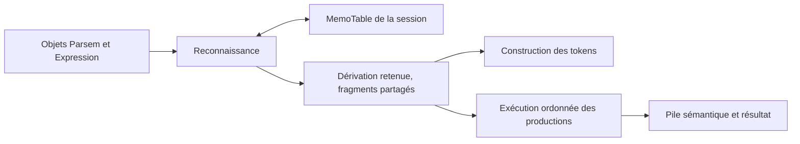

# Faire évoluer js-parsec vers Packrat

Analyse du 11 octobre 2026, sur les sources locales de `@cyann/js-parsec`
**0.2.6**, révision `3650014`.

## Recommandation

**Ajouter une mémoïsation de la reconnaissance, avec des résultats indépendants
de la pile sémantique, puis exécuter les productions sur la dérivation retenue.**
Conserver les classes, les combinators et leur écriture fluide. Introduire ce
fonctionnement comme un mode explicite, en préservant le mode actuel.

Une première expérience peut mémoïser un sous-ensemble syntaxique contrôlé.
En revanche, envelopper arbitrairement `Parsem.parse(ctx)` dans un cache
`(parseur, position) → résultat` ne serait pas correct pour toute la bibliothèque.
Les productions peuvent consommer des valeurs antérieures à leur propre entrée,
et les captures terminales modifient la destination des caractères lus.

Cette note propose une évolution ; elle n’implémente aucun moteur Packrat.
Les noms de classes et API présentés plus bas sont des propositions.

## 1. Ce qui existe déjà

| Composant | Comportement observé | Conséquence pour Packrat |
| --- | --- | --- |
| [Parsem](src/Parsem.ts) | `parse(ctx)` retourne un `Result` et modifie le contexte. | Le statut seul ne représente pas tout le résultat à mémoriser. |
| [Expression](src/expression.ts) | Une référence mutable permet les règles récursives ; `parse` délègue à `ref.parse`. | Bon point d’entrée pour une expérimentation, mais la grammaire doit rester stable pendant une session. |
| [Choice](src/choice.ts) | Alternatives essayées dans l’ordre ; la première `Parsed` est retenue. | Conserver cet ordre et mémoïser aussi les échecs. |
| [Sequence](src/sequence.ts) | Sauvegarde avant la séquence et restauration en cas d’échec. | Le cache doit préserver exactement les effets observables de ce parcours. |
| [Repeat](src/repeat.ts) | Répétition gourmande avec boucle et contrôle de progression. | Les résultats intermédiaires des suffixes ne sont pas mémoïsés. |
| [Optional](src/optional.ts) | Un échec devient `Continue`. | Préserver les trois statuts, y compris les résultats de largeur nulle. |
| [Context](src/runtime/Context.ts) | Position, tokens, pile de valeurs et pile de captures terminales. | La position ne décrit pas tout l’état d’exécution. |
| [ProductT](src/productT.ts) / [ProductNT](src/productNT.ts) | Callbacks exécutés pendant le parsing. | Leur résultat peut dépendre d’un état externe à la règle ou avoir des effets de bord. |

Il n’y a actuellement ni table de mémoïsation ni passage commun par lequel
transitent tous les appels aux parseurs enfants.

Les corrections récentes sont présentes dans les sources examinées :
`Context.handleBackup` sauvegarde les valeurs de la pile, pas seulement sa taille ;
les productions terminales conservent `0`, `false`, `''` et `null`.
Les **166 tests passent**, dont les **14 invariants PEG** de
[PEGInvariants.test.ts](tests/PEGInvariants.test.ts). La compilation passe aussi.
Ce constat concerne ce projet source ; il ne signifie pas que toutes les
applications consommatrices utilisent déjà cette version.

Le moteur conserve une particularité : `Choice` ignore `Continue`, même si
l’alternative a reconnu une expression vide. Par exemple,
`choice(optional(wordIs('a')), wordIs('b'))` peut reconnaître `b`.
Dans le choix ordonné d’un PEG classique, la réussite vide de la première branche
engagerait le choix. Ajouter Packrat n’oblige pas à changer cette convention ;
il faut la documenter et conserver ses tests. Le README et la description du
paquet emploient encore les anciens labels LL(1)/LL(*) : leur actualisation
devrait accompagner une future publication.

## 2. L’ajout central : une table par session de parsing

Packrat mémorise les résultats des applications de règles pour éviter de les
recalculer après un retour arrière. Pour une grammaire fixe et une entrée
immuable, la clé de reconnaissance est l’identité du parseur et la position.
Succès et échecs sont conservés. La borne linéaire dépend aussi d’un travail
borné par cellule ; les combinators itératifs peuvent violer cette condition.
[Ford, ICFP 2002, sections 2.3–2.4 et 3.3](https://bford.info/pub/lang/packrat-icfp02.pdf).

Une classe `MemoTable` appartenant à la session pourrait utiliser, au départ :

```ts
Map<Parsem<unknown>, Map<number, MemoCell>>
```

L’identité de l’objet suffit : deux instances reconnaissant le même texte
peuvent porter des productions différentes. `toString()` ne convient pas comme
identifiant. Des identifiants numériques pourront être envisagés après mesure.

La table doit :

- être propre à une entrée et à une configuration de grammaire ;
- conserver `Parsed`, `NotParsed` et `Continue`, sans tests de vérité implicites ;
- rester disponible après le rollback d’une alternative ;
- mémoriser les positions de fin et des fragments de reconnaissance réutilisables ;
- distinguer une cellule absente, une cellule en cours de calcul et une cellule terminée ;
- être libérée ou réinitialisée explicitement à la fin de la session.

Un schéma possible, pour le futur moteur de reconnaissance :

```ts
type MemoCell =
    | { state: 'evaluating' }
    | {
        state: 'complete'
        status: Result
        end: number
        fragment: RecognitionFragment | null
    }
```

`RecognitionFragment` représenterait une dérivation immuable : références aux
fragments enfants, intervalles du texte et informations de production.
Ce serait un nouvel objet métier ; il n’existe pas dans le code actuel.
Les échecs ne doivent conserver aucun effet sémantique d’une branche abandonnée.

### Où intercepter les appels ?

Pour une expérience limitée, un `MemoizedParsem` héritant de `ParsemDecorator`
permettrait de conserver `Parsem.parse(ctx)` et les parseurs personnalisés.
Son périmètre devrait être explicite : reconnaissance déterministe, grammaire
stable et aucune dépendance non représentée dans le résultat mémorisé.
Exclure seulement `ProductNT` à la racine ne suffit pas si ses descendants ou
les captures environnantes réintroduisent cette dépendance.

Pour le mode complet, je préfère une méthode commune de session, par exemple
`ctx.apply(parser)`, utilisée par les composites, décorateurs et expressions.
L’entrée racine doit emprunter ce même passage. Elle gèrerait la recherche dans
la table, le marqueur de calcul, l’évaluation et la réutilisation du fragment.

Une autre solution serait le Template Method : `Parsem.parse` commun et une
méthode protégée `doParse` par classe. Elle cadre bien avec l’écriture objet,
mais obligerait les classes personnalisées qui redéfinissent actuellement
`parse` à migrer. Je privilégie d’abord l’option additive ; une migration du
contrat public mérite une décision séparée.

## 3. Pourquoi le cache naïf donnerait des résultats faux

### 3.1 Une production peut lire la pile créée avant la règle

`Utils.handleNTProduction` peut dépiler davantage de valeurs que l’expression
décorée n’en a produites. C’est utilisé dans l’exemple arithmétique du README :
`E.productNT((l, r) => l * r)` récupère aussi l’opérande gauche déjà sur la pile.

Voici un contre-exemple minimal, exécuté sur les sources actuelles :

```ts
const letter = productT(wordIs<unknown>('a'), value => value)
const rule = productNT(letter, (left, right) => `${left}${right}`, 2)

const parser = choice(
    sequence(productT(wordIs<unknown>('1'), () => 1), rule, wordIs('b')),
    sequence(productT(wordIs<unknown>('1'), () => 2), rule, wordIs('c'))
)

const ctx = new Context<unknown>('1ac')
parser.parse(ctx)
// ctx.result === '2a'
```

La même instance `rule` est appelée à la position **1**, d’abord avec `[1]` sur
la pile, puis avec `[2]`. Son callback reçoit respectivement `[1, 'a']` et
`[2, 'a']`. Réutiliser la valeur `'1a'` calculée au premier passage serait faux.
Réinjecter le snapshot complet du premier contexte serait également faux.

Ajouter toute la pile à la clé ne résout pas simplement le problème : objets
mutables, égalité des valeurs, coût de comparaison et nombre d’états deviennent
des paramètres du parsing. Avec un état supplémentaire, la borne dépend de ses
configurations, plus seulement des positions. Cette limite est également
étudiée par [Ford, thèse, sections 3.2.5 et 3.3.2](https://bford.info/pub/lang/thesis.pdf).

### 3.2 Une lecture ne produit pas toujours le même effet sur les tokens

`Context.next()` ajoute le caractère au builder terminal actif, ou crée un token
s’il n’y en a pas. Une même reconnaissance de `wordIs('a')`, à la même position,
peut donc participer à une capture englobante ou produire de la ponctuation.

Un cache de tokens déjà matérialisés ne peut pas être rejoué aveuglément dans
ces deux situations. Le fragment mémorisé doit représenter la reconnaissance
et les limites de capture ; la construction des tokens doit respecter le
contexte de capture dans lequel ce fragment est utilisé.

### 3.3 Une action JavaScript n’est pas nécessairement pure

Un callback peut incrémenter un compteur, modifier un objet, retourner une
closure ou lancer une exception. Réutiliser son résultat peut supprimer un appel
attendu ; le réexécuter peut reproduire un effet de bord.

Le rollback actuel restaure les références de la pile, pas les mutations
internes des objets ni les effets sur une variable capturée. De plus, une
exception dans la fonction passée à `handleBackup` ne déclenche pas sa branche
de restauration. La nouvelle session devra nettoyer ses cellules en cours et
ses captures sur exception, même si l’erreur reste fatale.

Il faut définir le contrat des actions avant d’activer le cache, plutôt que
d’essayer de corriger ces cas par clonage automatique ou par sérialisation JSON.

## 4. Séparer reconnaissance et exécution des productions

L’architecture que je recommande reste orientée objet et s’appuie sur les
composites existants :



La reconnaissance retourne un statut, une position de fin et un fragment ;
elle n’exécute pas les callbacks. Les choix abandonnés ne sont pas évalués
sémantiquement. Le parcours final matérialise les tokens et exécute les productions
dans l’ordre correspondant à la dérivation retenue.

Pour préserver les grammaires existantes, ce parcours doit respecter :

- les captures `ProductT`, leur type de token et leur intervalle de texte ;
- les réductions `ProductNT`, y compris la lecture de valeurs antérieures ;
- le nombre d’arguments explicite ou inféré, les arguments rest et les callbacks sans argument ;
- les trois statuts : une production attachée à `Continue` n’est pas exécutée actuellement ;
- les valeurs `0`, `false`, `''`, `null`, tableaux et fonctions.

Une dérivation avec des instructions de production différées permettrait de
réappliquer `rule` à la pile courante du contre-exemple, plutôt que de réutiliser
une ancienne valeur. Les marqueurs d’entrée des productions non terminales
restent nécessaires pour calculer les arguments rest. Les valeurs ne peuvent
pas être réduites exclusivement aux enfants d’un AST local : l’opérande gauche
de l’arithmétique peut se trouver hors du sous-arbre décoré.

**C’est un changement du moment et du nombre d’exécutions des callbacks.** Une
action aujourd’hui exécutée dans une branche ensuite abandonnée ne le serait
plus. Une exception dans cette branche pourrait également disparaître.
Ce mode doit donc être opt-in, avec cette différence documentée. Les parseurs
personnalisés dont les décisions dépendent de valeurs sémantiques ou d’un état
mutable ne sont pas automatiquement admissibles à la reconnaissance différée.

Une règle produisant des objets doit aussi définir leur propriété : partager
un résultat sémantique mutable entre plusieurs occurrences n’est pas neutre.
Partager le fragment de reconnaissance est préférable à partager arbitrairement
la valeur produite ; le parcours sémantique traite chaque occurrence retenue.

## 5. La garantie linéaire exige plus que la table

Pour ce projet, les conditions d’acceptation seraient : grammaire fixe pendant
la session, couverture des calculs récursifs, résultats indépendants des valeurs
d’entrée de la pile, et opérations de reconnaissance de coût borné par cellule.
Le coût des callbacks utilisateur doit être mesuré séparément.

### Répétitions

La boucle de `Repeat.parse` peut scanner un suffixe entier pour chaque position.
Même si le résultat de chaque `Repeat` est calculé une seule fois à chaque
position, la somme des longueurs des suffixes reste quadratique.

Cas exécuté sur le moteur actuel :

```ts
const scan = repeat(charIn('a'))
const parser = repeat(choice(sequence(scan, wordIs('x')), wordIs('a')))
// Entrée : uniquement des 'a'. Le scan réussit, 'x' échoue, puis on avance d'un 'a'.
```

| Nombre de `a` | Appels au parseur `charIn` situé dans `scan` |
| ---: | ---: |
| 16 | 137 |
| 32 | 529 |
| 64 | 2 081 |

Ces comptes sont des observations du moteur sans cache. Avec un cache sur les
enfants, les boucles pourraient encore effectuer un nombre quadratique de
consultations, même si les reconnaissances élémentaires ne sont plus recalculées.

Il faudrait calculer et partager les continuations de répétition par position,
avec des fragments chaînés, ou normaliser cette opération en règles internes
mémoïsées. Une boucle de calcul ou une pile explicite éviteraient de remplacer
le problème par une profondeur d’appel proportionnelle à la taille du texte.
Il faut conserver la gourmandise, la dernière tentative échouée et les statuts
spécifiques de `Repeat`, sans recopier mécaniquement une définition PEG abstraite.

### Sauvegardes, copies et captures

`handleBackup` copie aujourd’hui toute la pile de valeurs. C’est correct pour
restaurer les valeurs consommées, mais son coût augmente avec la profondeur de
pile. Dans le mode différé, la reconnaissance n’a plus besoin de cette pile.
Si le mode actuel devait être optimisé, une pile persistante ou un journal de
mutations serait une piste distincte ; revenir aux seules tailles ferait
réapparaître le défaut corrigé.

Ne pas stocker une copie complète des tokens, captures ou résultats descendants
dans chaque cellule : des suffixes partagés entraîneraient des duplications.
Conserver des fragments immuables reliés entre eux et des intervalles de texte,
puis matérialiser les sorties du parcours retenu.

Les littéraux et classes sont de taille fixe pour une grammaire fixe ; leurs
constantes de coût restent à mesurer. Les parseurs personnalisés qui scannent
un suffixe, les captures copiées et les actions arbitraires peuvent ajouter du
travail non borné. La promesse doit porter sur la reconnaissance sous les
conditions définies, pas sur toute exécution JavaScript de l’application.

### Un cas où la mémoïsation serait très utile

Sur la grammaire `R = 'a' R 'b' | 'a' R 'c' | 'd'`, l’entrée `aⁿe` a provoqué :

| `n` | Appels à la même règle récursive, tous offsets confondus |
| ---: | ---: |
| 8 | 511 |
| 10 | 2 047 |
| 12 | 8 191 |

Le nombre suit ici `2^(n+1) - 1`. Un cache des échecs de cette règle supprimerait
les réévaluations aux mêmes offsets. Ce cas est un bon futur test de compteurs,
plus fiable qu’une assertion sur un temps dépendant de la machine.

## 6. Mémoire, erreurs et récursion

### Mémoire

Prévoir jusqu’à `m × (n + 1)` cellules pour `m` parseurs mémoïsés et une entrée
de longueur `n`, sous les restrictions précédentes. Cela compte des cellules,
pas un nombre garanti d’octets. Les fragments, maps et objets ont aussi un coût.

Je commencerais avec une table sparse et des compteurs : évaluations réelles,
hits, misses, cellules et fragments. Mesurer ensuite le temps et le tas.
Un cache LRU ou une fenêtre glissante peut être utile, mais l’éviction autorise
les recalculs et retire la garantie générale recherchée. La réutilisation du
cache entre éditions de l’IDE exige une invalidation des dépendances ; elle
constitue un projet de parsing incrémental séparé.

### Erreurs

Le moteur possède aujourd’hui la vérification de consommation complète dans
`Context.result`, mais pas de diagnostic structuré « échec le plus lointain et
terminaux attendus ». Ajouter ce diagnostic serait utile, sans être nécessaire
à une première démonstration de mémoïsation.

S’il est ajouté, les cellules doivent conserver et réintégrer les contributions
aux diagnostics, y compris celles d’une règle qui finit par réussir après une
alternative échouée. Sinon, un cache hit peut changer le message d’erreur.
Les exceptions utilisateur ne doivent pas devenir des échecs syntaxiques mis
en cache ; la session doit nettoyer les cellules `evaluating` avant de les propager.

### Récursion gauche

Packrat n’ajoute pas automatiquement le support de la récursion gauche.
Pour la première version, un retour sur une cellule `evaluating` devrait produire
un diagnostic clair de cycle sans progression, plutôt qu’un dépassement de pile.
Le garde-fou des répétitions de largeur nulle doit également rester actif.

Une extension ultérieure pourrait faire croître une reconnaissance initiale
jusqu’à ce qu’elle n’avance plus. La récursion indirecte exige le suivi du cycle
de règles, pas seulement une boucle sur une règle isolée. Certains cas de cet
algorithme sont superlinéaires : [Warth, Douglass et Millstein, PEPM 2008](https://www.cs.ucla.edu/~todd/research/pepm08.pdf).
Je la traiterais après la mémoïsation et les productions différées.

## 7. Plan de réalisation proposé

| Étape | Livrable | Critère de validation |
| --- | --- | --- |
| 1. Définir le périmètre | Contrat de reconnaissance mémoïsable, actions et grammaire stable. | Le cas `'2a'` et les captures terminales ne peuvent pas recevoir une réponse provenant d’un autre état. |
| 2. Prototype limité | `MemoTable` par session, interception additive, échecs mémorisés, compteurs. | Réévaluations supprimées sur les règles admissibles ; résultat identique sans promettre encore la linéarité générale. |
| 3. Mode différé | Fragments partagés, parcours sémantique et construction des tokens. | Arithmétique, arguments rest, valeurs particulières et closures restent corrects dans le mode documenté. |
| 4. Compléter la couverture | Passage commun pour les appels, répétitions avec continuations mémoïsées, copies bornées. | Compteurs compatibles avec la borne annoncée sur les grammaires adversariales. |
| 5. Intégrer et documenter | Tests sur les vrais consommateurs, diagnostics, métriques et API stabilisée. | Archives et exécuteurs de Grammar Lab validés séparément contre la version effectivement installée. |

Pour la première version, je laisserais hors périmètre la récursion gauche,
le parsing incrémental, les décisions syntaxiques dépendant d’un état mutable
et la mise en cache des effets externes. Les prédicats de lookahead pourraient
être ajoutés plus tard ; ils ne sont pas requis pour mémoïser le langage actuel.
Aucune nouvelle dépendance n’est nécessaire pour commencer.

## 8. Tests à ajouter avant d’annoncer Packrat

La suite [PackratInvariants.test.ts](tests/PackratInvariants.test.ts) couvre
désormais les contrats de mémoïsation, les cycles sans progression et la
compatibilité de l'état observable. Elle sollicite les points de cache réels
et compare aussi des grammaires avec et sans partage de règles.
[tests/README.md](tests/README.md) précise leur exécution et leur portée.
`PEGInvariants.test.ts` reste la référence du comportement actuel.

Dans le commit `100107a`, `Context.getMemo`/`setMemo` utilisent l'identité des
instances et `Utils.handlePackrat` consulte et alimente effectivement cette
table. [PackratMemo.test.ts](tests/runtime/PackratMemo.test.ts) vérifie cette
API. Le rejeu ne restaure encore que position et statut : les invariants
exposent des pertes de tokens, captures et valeurs. Ils détectent aussi une
collision entre l'optionnel et la répétition d'un même enfant.
`handleSeedGrowing` reste préparatoire ; les diagnostics de cycles demeurent
des contrats à satisfaire.

| Famille | Vérifications |
| --- | --- |
| Identité et durée de vie | Même parseur/même offset calculé une fois ; parseurs différents séparés ; aucun partage entre sources ; mutation de `ref` pendant la session refusée ou invalidation explicite. |
| Statuts | Hits sur `Parsed`, `NotParsed`, `Continue`, EOF et absence de cellule distincts. |
| Alternatives | Priorité inchangée, échec partiel, même règle réutilisée après rollback et échec mémoïsé. |
| État sémantique | Contre-exemple `'1ac' → '2a'`, valeurs antérieures consommées, arguments rest, zéro argument et valeurs `0`/`false`/`''`/`null`. |
| Captures | Reconnaissance avec et sans builder actif, captures imbriquées, tokens identiques avec/sans mémoïsation. |
| Actions | Fréquence d’appel définie pour le mode différé, effets des branches abandonnées absents, exceptions fatales nettoyant la session, closures et objets mutables. |
| Récursion | Références anticipées, récursion droite, diagnostic de cycle direct/indirect sans progression, répétition vide refusée. |
| Complexité | Cas récursif `aⁿe`, scans de suffixes, copies de fragments et nombre de consultations ; tailles croissantes, avec compteurs plutôt que seuils de durée en tests unitaires. |
| Intégration | Les cinq exemples de Grammar Lab, consommation complète, tokens, résultat et AST ; ZIP et modules exécutables vérifiés avec la bibliothèque cible. |

Les benchmarks sépareraient reconnaissance, matérialisation des tokens,
actions, mémoire et profondeur d’appel. Doubler la taille d’une entrée et
observer un temps proche du double ne constitue pas, seul, une preuve de borne.

## 9. Vérifications réalisées pour cette note

- Lecture des classes du moteur, des productions, du contexte, du README et des invariants.
- `npm test` : **166 tests réussis, 0 échec**.
- `npm run build` : **réussi**.
- Exécution des trois expériences présentées : pile différente au même offset,
  réévaluations récursives et scans successifs de suffixes. Les compteurs ont
  été obtenus avec un petit décorateur déléguant aux vrais parseurs.
- Consultation des publications primaires citées pour la mémoïsation,
  ses conditions de complexité, l’état et la récursion gauche.

Les expériences mesurent le moteur actuel sans cache. Aucun prototype Packrat,
benchmark mémoire ni intégration d’un nouveau mode dans l’IDE n’a été réalisé.
